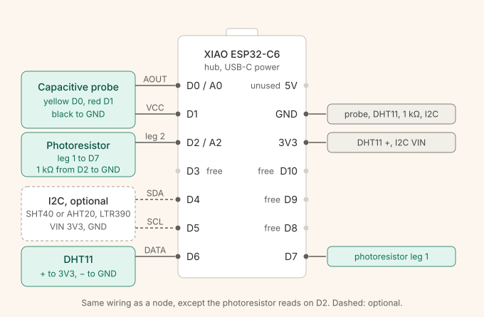

# GROUNDWELL v0.12: factory-calibrated nodes, soil, air, light and UV at the plant, sensors on the hub too, a 0-100 health score, cloud history

```
[XIAO nRF52840 node] --Bluetooth, every 30 s--> [XIAO ESP32-C6 hub] --HTTPS, every 60 s--> [Cloudflare Worker + D1]
  capacitive probe                               live dashboard on Wi-Fi                     history dashboard + CSV
                                                 names, calibration                          health score, every hour in the background
                                                 its own probe, air + light (optional)
                                                 health check of the whole chain (/diag)
  SHT40 / AHT20 / DHT11 air temp + humidity      air + light on every card                   diagnoses, ranges, watering schedule
  LTR390 / VEML7700 / GL5539 light, LTR390 UV                                                air + light history, once a minute
```

**Versions:** node firmware v0.12.0 (XIAO and the Nano ESP32 test node), hub firmware v0.12.0 (the hub updates its nodes for you, section 6; diagnostics and health checks, section 5; sensors on the hub, section 4b), cloud v0.9 (one new column, added automatically on first use; no migration step). The node reads light from the GL5539 photoresistor by default; set `LIGHT_SENSOR` to `LIGHT_I2C` in the node sketch for I2C sensors (section 1b).

**New in v0.12**
- **Sensors on the hub** (section 4b). The hub can carry its own capacitive probe, DHT11 and photoresistor (or SHT40/AHT20 and LTR390 on I2C), wired the same way as a node. It reads them every 30 s with the node's own code and they show up as one more pot, "wired to this hub", on both dashboards. Turn them on at `/setup`; factory calibration works over USB with `factory_cal.py`, as for a node.
- **Health check of the whole chain** on `http://plants.local/diag` (section 5): one verdict, a tile for each link (nodes, Bluetooth, the hub's sensors, the hub, Wi-Fi, cloud), and a list of findings with what to do. Per node, over the last hour: readings received against expected, dropped readings, timing against the expected interval, copies heard of each reading (link margin), signal, battery, firmware against the version the hub carries, and how far behind the cloud is.
- **The rod probe is gone.** The capacitive probe is the soil sensor. The node no longer reads or sends rods (the packet is 3 bytes shorter) and pins D2, D3 and D4 are free. When the hub updates a node, that node's rod card disappears on its own. Its old history stays in the cloud; delete it there if you like.
- **Fix: false node restarts.** The packet id is one byte, and v0.11 took its 255-to-0 wrap (every 256 readings, about every 2 h 8 min) for a restart: it logged "Node restarted", counted it, and checked the node over Bluetooth, about 11 extra connections a day per node on a coin cell. The hub now tells the wrap from a restart, and spots a node that has just been reset by its continuous advertising in its link window.
- **Smaller hub firmware:** the dashboard and diagnostics pages are stored gzipped (about 27 KB less), so the hub with its sensors and the node firmware inside still fits one update slot.

**New in v0.9**
- **Battery profile, on USB or battery alike.** The node reads every 30 s instead of 5 s, broadcasts each reading in a 6 s burst and then turns the radio off, and keeps every sensor powered down or in standby between readings. The CPU already slept between readings.
- **Better air, light and UV sensors on I2C, found automatically** (section 1b): Sensirion SHT40/41/45 or AHT20 for temperature and humidity (the DHT11 stays as the fallback), VEML7700 or LTR390 for light, and the LTR390 for the UV index. The UV index shows on the Light tab and the hub page.
- **Air glitch filter.** A temperature or humidity reading that jumps more than 3 °C or 15% RH is held back until the next reading confirms it, so a corrupted DHT11 frame never reaches the charts. A real change, like breathing on the sensor, still shows one reading later.
- **Cloud usage cut by about 70%.** The cloud now stores one soil reading per probe per minute (the average of what arrived), the hub uploads once a minute, and the dashboard refreshes its charts every 5 minutes. Measured on a local copy of the Worker: about 14,000 database row writes a day per node, against the free plan's 100,000 (it was about 52,000). This works with the old hub too, so deploying the cloud alone gets most of the saving.
- **Battery % is no longer in the packet;** the supply voltage carries the same information and the two bytes make room for UV inside the 31-byte Bluetooth broadcast. v0.6 nodes still work with a v0.9 hub and cloud.
- **`FAST` serial command:** 5 s readings for 5 minutes, for bench tests. `tools/factory_cal.py` sends it automatically, so factory calibration runs at the old pace.

**New in v0.7**
- **Calibrate from the cloud dashboard.** Admin > Calibrate on each pot: Set dry = now, Set wet = now (the average of the last minute of readings), typed values, probe names, and Back to defaults. The cloud hands each change to the hub in its reply to the next upload (within 30 s); the hub applies and saves it exactly as its own page would, so both pages always agree. Each probe shows whether the hub has picked the change up. Needs hub firmware v0.6.2.
- **Plant nicknames.** Tap the pencil next to a pot's name to call it anything you like ("Fernando"). The nickname shows on the garden shelf and the pot's page; the plant type stays underneath.
- **Optional `ADMIN_KEY`:** set it to require a key for calibration changes from the dashboard (section 3).

**New in v0.6**
- **Factory calibration on the node.** Each node is calibrated once in air and in water over USB, and stores it in its own flash. It then sends moisture on its own probe scale (0 = air, 100 = water), so a node ships calibrated with no plant, no soil and no hub settings. See section 2b.
- **Fixture script:** `tools/factory_cal.py` runs a node through a timing check, the air and water points, and a verify step, then logs one row per unit to a CSV.
- **User and Admin tabs on the hub page.** It's the v0.5 page; the User tab hides the calibration panels, the Admin tab has them. An optional `ADMIN_PIN` on the hub locks calibration changes. The cloud dashboard has a User / Admin switch too, which hides the CSV buttons and the probe table.
- **Soil mapping on the hub:** `SOIL_DRY_PS` and `SOIL_WET_PS` turn the probe scale into soil moisture for every factory-calibrated node. Admin can fine-tune a single pot.
- **Timing fixes:** the node now waits on the clock until each reading is due, so it can't send early. The hub keeps at most one reading per node interval, and Admin shows each node's measured interval, flagged in red when it isn't 5 s.

**New in v0.5**
- A light sensor on each node: a GL5539 photoresistor. See section 1 for the wiring.
- A health score from 0 to 100 for each pot, built from five factors: water, light, air (VPD), temperature, and vigor.
- Diagnoses read from the watering sawtooth: root rot risk, uptake drop, growing, resting for winter, slow drainage, light waterings, root-bound pot, and a covered light sensor.
- For each pot: recommended ranges next to its current values, a watering schedule, light advice in lux, and a sensor-position setting plus a leaf-level light check.
- An hourly background job that keeps a 90-day score history.
- How it all works, with sources: [`docs/HEALTH_ENGINE.md`](docs/HEALTH_ENGINE.md).

> **Where things live now:** this repo (`groundwell-firmware`) holds `node`, `hub`, the firmware `tools` and `legacy`. The cloud code (`cloud`, `docs/HEALTH_ENGINE.md`, the cloud test tools) lives in [`groundwell-cloud`](https://github.com/baolongtn/groundwell-cloud). Enclosures and old release zips are still in the local Groundwell folder.

| Folder | What it is |
|---|---|
| `node/GroundwellNode` | Arduino sketch for the XIAO nRF52840: reads both probes, air and light (and UV with an LTR390), broadcasts a BTHome v2 packet every 30 s |
| `hub/GroundwellHub` | Arduino sketch for the XIAO ESP32-C6: hears the nodes, serves the live dashboard, uploads to the cloud |
| `cloud` | Cloudflare Worker + D1 database: stores every reading, scores every pot, serves the dashboard and CSV export |
| `docs` | `HEALTH_ENGINE.md`: how the score, diagnoses and schedule are worked out, with sources |
| `tools` | `factory_cal.py` (factory calibration fixture), packet round-trip test, sensor math test (SHT4x, AHT20, LTR390, glitch filter), photoresistor conversion test, health-engine scenario tests, a plant simulator, a hub simulator, a demo-history loader, and a fake node for testing the fixture |
| `hardware/enclosures` | 3D-printable node and hub enclosures: STLs, previews, and the parametric generator |
| `releases` | `v0.4` (previous package, for reference) and `v0.5/Groundwell.zip` (the v0.5 package as downloaded) |
| `legacy/wired-prototype` | The original wired ESP32-C6 sketches and the light-sensor test sketch |

Live design doc (BOMs, power budget, 10-test validation plan, v1 PCB): [Wireless Plant Monitor: Sensor and Hub Design](https://claude.ai/artifact/BEku31KBeJoz9UmX6UzCzm).

## 1. Wire the node

The capacitive probe, the DHT11 and the light sensor go on one XIAO nRF52840. (The rod probe of earlier versions is gone in v0.12: the capacitive probe is the soil sensor, and D2, D3 and D4 are free.)

| Wire | XIAO nRF52840 pin | Notes |
|---|---|---|
| Capacitive: black (GND) | GND | |
| Capacitive: red (VCC) | D1 | Powered only for 150 ms per reading |
| Capacitive: yellow (AOUT) | D0 / A0 | |
| DHT11 S / DATA | D6 | Module labels vary; follow the printing on yours |
| DHT11 + / VCC | 3V3 | |
| DHT11 - / GND | GND | |
| Photoresistor leg 1 | D7 | Powered only for a few ms per reading. Either leg |
| Photoresistor leg 2 | D5 / A5 | |
| 1 kOhm resistor | D5 / A5 to GND | Bottom of the light divider |

```
        XIAO nRF52840
   cap GND ---- GND
   cap VCC ---- D1
   cap AOUT --- D0/A0
   DHT DATA --- D6
   DHT VCC ---- 3V3
   DHT GND ---- GND
   LDR leg 1 -- D7
   LDR leg 2 -- D5/A5 ---[1k]--- GND
```

- **Coming from an earlier build with rods:** unplug the rod probe and its 10 kOhm resistor (D2, D3, D4). Nothing else moves.
- **Coming from the v0.3 / soil-and-air build:** move the DHT11 data wire from D5 to D6, then add the photoresistor and its 1 kOhm resistor.
- **Photoresistor placement:** face it up at leaf height, where nothing shades it. Under a translucent cap it reads low.
- **Photoresistor resistor:** 1 kOhm spreads the readings evenly from about 10 to 100,000 lux. A 10 kOhm works, but its readings bunch up above about 10,000 lux; if you use one, set `LDR_FIXED_OHMS` to 10000.
- **Trimming the photoresistor:** GL5539 parts vary by up to about ±40%, so treat lux as an estimate. Hold a phone light-meter app beside the node in steady light and adjust `LDR_R10_OHMS` (higher reads brighter) until they agree. The default is the datasheet middle: 75 kOhm at 10 lux, gamma 0.8.
- **Leaves over the sensor:** the node sits low in the pot, so leaves shade the sensor and the plant's leaves get more light than it reads. The dashboard handles this: set the sensor position once, or run the leaf-level light check (section 5).

- **DHT11 placement:** mount it about 10 cm above the soil, out of direct sun and away from watering splash. That way it measures the air the leaves sit in, not the damp soil surface. The DHT11 isn't waterproof.
- **Bare DHT11:** if yours is the bare 4-pin sensor rather than a 3-pin module, add a 10 kOhm pull-up from DATA to 3V3. The module board already has one.
- **Capacitive probe check:** the timer chip on the probe should be marked **TLC555**. An NE555 misbehaves at 3.3 V.
- **Power:** USB-C or a battery; the node runs the same low-power cycle on both. Reading every 30 s, the average draw is dominated by the capacitive probe (about 5 mA for 150 ms per reading) and, if fitted, the DHT11's standby current; an SHT40 in its place idles at about 0.1 µA. If you ever fit a coin cell to the BAT pads, take it out before plugging in USB, because the XIAO's charger would try to charge it.

## 1b. Optional: I2C sensors (SHT40, AHT20, LTR390, VEML7700)

Better air, light and UV sensors all share the XIAO's I2C pins, so they need the alternate wiring. Set `#define LIGHT_SENSOR LIGHT_I2C` in the node sketch, then:

| Wire | XIAO nRF52840 pin | Notes |
|---|---|---|
| Every I2C board: SDA | D4 | Daisy-chain STEMMA QT boards, or wire them in parallel |
| Every I2C board: SCL | D5 | |
| Every I2C board: VIN / VCC | 3V3 | |
| Every I2C board: GND | GND | |
| Photoresistor | not used | The LTR390 or VEML7700 measures light instead |
| DHT11 | D6, as before | Optional; used only if no SHT4x or AHT20 is found |

At boot the node looks for each sensor and uses the best one it finds: SHT4x (0x44), then AHT20 (0x38), then the DHT11 for air; VEML7700 (0x10), then the LTR390's ambient light (0x53) for light; the LTR390 for UV. Serial Monitor prints what it found, for example `I2C sensors on D4/D5: air sht4x, light ltr390, UV ltr390`. The SHT4x, AHT20 and LTR390 need no extra library; the VEML7700 needs "Adafruit VEML7700 Library".

- **UV index indoors:** window glass blocks most UV, so expect readings near 0 indoors. UV matters for pots on a patio or under a skylight.
- **Air sensor placement:** in open air at leaf height, away from the board, heat vents and direct sun.


## 2. Flash the node

1. **Add the board package.** In Arduino IDE, go to File > Preferences and add this to Additional Boards Manager URLs:
   `https://files.seeedstudio.com/arduino/package_seeeduino_boards_index.json`
2. **Install the core.** In Boards Manager, install **"Seeed nRF52 Boards"**. Do not use the "mbed-enabled" one.
3. **Install the libraries:** Tools > Manage Libraries:
   - **"DHT sensor library"** by Adafruit, with its "Adafruit Unified Sensor" dependency
4. **Select the board:** Tools > Board > **Seeed XIAO nRF52840**.
5. **Upload** `node/GroundwellNode`. Serial Monitor (115200) prints its address and a line every 30 s, for example:
   `#12 dt=30000ms  capacitive 2873 (uncal)  air 23.5 C 47%RH  light 9258 lux (adc 3108)  VDD 3.30 V`
   - `dt` is the time since the last reading and should always be about 30000. Type `FAST` for 5 s readings over the next 5 minutes. After factory calibration (section 2b) the capacitive part reads like `capacitive 2283 =  49.9%`.
   - The flash storage for calibration (LittleFS) comes with the Seeed nRF52 core; there's nothing extra to install.
   - If the air sensor isn't answering, the line says `air: dht11 read failed`. The soil readings still go out. A reading the glitch filter holds back shows as `held (jump)`.
   - Photoresistor: cover it with your hand and the adc number should fall toward 0; shine a phone torch on it and it should rise toward 4000. A steady `light 0 lux (adc 0)` in a lit room means a loose leg or a missing 1 kOhm.

Quick check, with the probe in air and then in a cup of water: the capacitive count is high in air (roughly 3000 to 3600) and drops in water.

## 2b. Factory calibration (no plant needed)

Every node is calibrated once, before it ships, against two references anyone can reproduce: open air and water. The node stores the result in its own flash and from then on sends moisture on its own probe scale: 0 = its air reading, 100 = its water reading. That removes the unit-to-unit differences between probes (timer chips, coating thickness, board tolerances). The hub then maps the probe scale to soil with one setting for all nodes (section 4).

**Update the hub to v0.6 or later first.** A v0.5 hub doesn't understand the calibrated moisture value.

**Reference conditions** (keep them identical for every unit):
- **Air:** probe clean and dry, in open air, at least 5 cm from hands, metal and the bench.
- **Water:** distilled or deionized water at room temperature (about 22 °C), probe immersed to its max line, at least 3 cm from the container's walls and bottom. Tap water varies from place to place, so don't use it.

**With the fixture script** (recommended): `pip install pyserial`, close Arduino's Serial Monitor, plug in the node, then:

```
cd tools
python factory_cal.py --operator BN            # one node
python factory_cal.py --operator BN --batch    # one after another
```

It walks you through each step and checks:

| Step | Pass criterion |
|---|---|
| Timing | Readings arrive every 4.5 to 5.5 s (the script switches v0.9 nodes to 5 s with `FAST` first) |
| Air point | 20 readings over 10 s, standard deviation at most 15 counts; mean 2400 to 3900 |
| Water point | Same steadiness; mean 300 to 2600; air minus water at least 700 |
| Verify in water | Reads at least 95% |
| Verify back in air | Reads at most 5% |

Each unit adds a row to `factory_cal_log.csv`: time, operator, MAC address, firmware, PASS or FAIL with the reason, both points, span, noise and the verify readings. Limits live at the top of the node sketch (`CAL_*`) and the script (`WATER_MIN_PCT`, `AIR_MAX_PCT`).

**By hand** in Serial Monitor (115200, line ending "Newline"): `INFO`, `CAL AIR`, `CAL WATER`, `CAL SET <air> <water>`, `CAL CLEAR`. After a pass the node prints `CAL RESULT PASS air=3115 water=1452 span=1663 saved`, and every serial line shows the calibrated value, for example `capacitive 2283 =  49.9%`.

**The hub's own probe** (section 4b) is calibrated the same way: plug the hub in by USB and run the same command. The script finds the hub by itself, says `Hub` instead of `Node`, and the hub keeps the calibration in its settings memory, so updates keep it too.

## 2c. Optional: a test node on an Arduino Nano ESP32

Short on XIAOs? The same node sketch builds for an **Arduino Nano ESP32**. It sends the same Bluetooth packet, so the hub and cloud treat it as another node, and it takes the same serial commands, so section 2b calibrates it the same way. It is a bench node, not a product node.

**Wiring.** On the Nano, D and A pins are separate pins (on the XIAO, D0 and A0 are one pin). Every pin is 3.3 V only: power the sensors from **3V3**, never 5V or VBUS.

| Wire | XIAO nRF52840 | Nano ESP32 |
|---|---|---|
| Capacitive: black (GND) | GND | GND |
| Capacitive: red (VCC) | D1 | **D2** |
| Capacitive: yellow (AOUT) | D0 / A0 | **A0** |
| DHT11 DATA / + / - | D6 / 3V3 / GND | D6 / 3V3 / GND |
| Photoresistor leg 1 | D7 | D7 |
| Photoresistor leg 2 | D5 / A5 | **A3** |
| 1 kOhm resistor | D5 / A5 to GND | **A3** to GND |
| I2C sensors (`LIGHT_I2C`) | SDA D4, SCL D5 | SDA **A4**, SCL **A5** |

All the analog inputs sit on A0 to A3, the ESP32-S3's ADC1. D0/D1 are the Nano's serial pins, which is why the probe power moves to D2.

**Flash it.**
1. Board package: either works. **"esp32" 3.x** by Espressif (the one the hub already uses; not 4.0), or Arduino's own **"Arduino ESP32 Boards"** (2.0.x), which Arduino IDE offers when you plug in a Nano.
2. Tools > Board > **Arduino Nano ESP32** (it appears under both packages if you have both). Leave Tools > Pin Numbering on **By Arduino pin (default)**.
3. Libraries: the same "DHT sensor library". The Bluetooth library comes with the esp32 package.
4. Upload `node/GroundwellNode`. The banner says `Arduino Nano ESP32 test node: broadcast only`, and the reading lines look like the XIAO's.
5. Run factory calibration (section 2b). `factory_cal.py` finds a Nano ESP32 by itself, like a XIAO. Calibrate even if you only want raw numbers: its ADC reads differently from the XIAO's, and calibration puts its capacitive probe on the same 0 to 100 scale.

Every push also builds it on GitHub: Actions > latest run > Artifacts > `node-nano-esp32/GroundwellNode-nano-esp32.bin` (and `GroundwellNode-nano-esp32.merged.bin`, which a web flasher writes at address 0). Arduino IDE from source is the easier way to flash a Nano.

**Keeping it current.** The hub never updates a Nano, so when a release changes the node firmware, upload the sketch to the Nano over USB again. It keeps its calibration (stored in its own settings memory, which an upload doesn't erase). Its firmware version matches the XIAO's: the serial banner and `INFO` show it.

**How it differs from a XIAO node.**
- **Broadcast only.** Its adverts don't accept connections, so the hub reads them but never links or updates this node. Update it over USB. The hub's node list shows its firmware as unchecked, which is expected.
- **Power.** It runs on USB and never sleeps (tens of mA, against microamps for the XIAO), so it tells you nothing about battery life. It reports a fixed 3.30 V, because the ESP32 can't measure its own supply, so its battery level always reads full.
- **ADC.** The ESP32's ADC isn't referenced to the supply. The sketch reads calibrated millivolts and scales them to the 3.3 V rail, so the same math applies, but inputs top out near 3.1 V: the photoresistor saturates around 70,000 lux (direct sun). Lux is an estimate on either board.

## 3. Set up the cloud (free Cloudflare account, about 10 minutes)

**Windows shortcut:** `setup-cloud.ps1` in the top folder runs every step below and fills `CLOUD_URL`, `INGEST_KEY` and (optionally) your Wi-Fi into the hub sketch. Run `powershell -ExecutionPolicy Bypass -File .\setup-cloud.ps1` from the Groundwell folder. It saves the key to `cloud\INGEST_KEY.txt`; keep that file private.

You need Node.js LTS from nodejs.org. Open a terminal in the `cloud` folder:

```
npm install
npx wrangler login                                       # opens the browser; create or sign in to a free Cloudflare account
npx wrangler d1 create groundwell                        # copy the database_id it prints into wrangler.toml
npx wrangler d1 execute groundwell --remote --file=schema.sql
npx wrangler secret put INGEST_KEY                       # paste a long random string; the hub uses the same one
npx wrangler deploy                                      # prints https://groundwell.<your-subdomain>.workers.dev
```

- **Generate a key:** `node -e "console.log(require('crypto').randomBytes(24).toString('hex'))"`
- **Optional password:** `npx wrangler secret put VIEW_KEY` makes the dashboard ask for that key before showing data.
- **Optional admin key:** `npx wrangler secret put ADMIN_KEY` makes the dashboard ask for that key before changing calibration. Nicknames and the plant choice only need the view key.
- **Already deployed an earlier version?** Run the migrations you haven't applied yet, then redeploy:
  - From v0.2: `npx wrangler d1 execute groundwell --remote --file=migrate_v0.3.sql`
  - From v0.2 or v0.3: `npx wrangler d1 execute groundwell --remote --file=migrate_v0.4.sql`
  - From v0.4 or earlier: `npx wrangler d1 execute groundwell --remote --file=migrate_v0.5.sql`
  - **Keep your `database_id`:** v0.5's `wrangler.toml` adds an hourly cron (`"5 * * * *"`) for the background scoring. Copy your `database_id` into the new file, or add that cron line to your old one.
  - Then: `npx wrangler deploy`
- **Test without hardware:** `python3 ../tools/simulate_hub.py https://groundwell.<you>.workers.dev <INGEST_KEY>` uploads 6 hours of fake readings (soil, air, light) under hub "sim". The script prints the command to delete them afterwards.
- **See a fully trained dashboard locally:** the score needs a few weeks of history to learn each plant's rhythm. To see it right away, load two months of simulated history for four demo pots into a local database:
  ```
  node ../tools/simulate_history.mjs > /tmp/gw_history.sql
  npx wrangler d1 execute groundwell --local --file=schema.sql
  npx wrangler d1 execute groundwell --local --file=/tmp/gw_history.sql
  npx wrangler dev
  ```
  Open `http://127.0.0.1:8787` and pick hub "demo". The four pots are a healthy monstera, a calathea in dry air, an overwatered snake plant losing its roots, and a pothos in a dim corner.

## 4. Flash the hub

The first v0.9.1 flash goes over USB. After that, updates go over Wi-Fi (section 6).

1. **Board package:** "esp32 by Espressif Systems" **3.x** in Boards Manager. Don't move to 4.0: it replaced the Bluetooth library the hub uses, and the sketch won't compile on it.
2. **Optional `secrets.h`:** copy `hub/GroundwellHub/secrets.example.h` to `secrets.h` in the same folder and fill in `WIFI_SSID`, `WIFI_PASS`, `CLOUD_URL` (`https://groundwell.<your-subdomain>.workers.dev/api/ingest`) and `INGEST_KEY` (the string you gave Cloudflare). The hub then joins your Wi-Fi straight away. Without it, the hub opens its setup hotspot (step 5). `secrets.h` is git-ignored.
3. **Check the settings block** at the top of `GroundwellHub.ino`:
   - `USE_EXTERNAL_ANTENNA 1` if you plug in a U.FL antenna; it helps both Wi-Fi and Bluetooth range
   - `ADMIN_PIN`: leave `""` to let anyone on your Wi-Fi open the Admin view, or set digits to require a PIN for it and for calibration changes
   - `SOIL_DRY_PS` / `SOIL_WET_PS`: where bone-dry and freshly drained potting mix land on the probe scale. The defaults (30 and 75) are starting values from typical capacitive-probe data. Replace them with your own lab numbers: a few factory-calibrated probes in your potting mix, bone-dry and then watered and drained, checked on a kitchen scale (design doc test 6).
4. **Select the board** XIAO_ESP32C6, set **Tools > Partition Scheme > Huge APP (3MB No OTA/1MB SPIFFS)**, and **Upload**. The menu only sets the IDE's size check (the Default scheme allows 1.25 MB, too small for the hub). `partitions.csv` in the sketch folder replaces the layout with two 1.875 MB app slots, so the IDE's "Maximum is 3145728 bytes" overstates it: the real limit is 1,966,080 bytes, which the GitHub build checks. Names and calibration already on the hub survive the switch.
   - **No Arduino IDE?** Download the build from GitHub (repo > Actions > latest run > Artifacts) and flash `GroundwellHub.ino.merged.bin` at address 0 with Espressif's web flasher in Chrome.
5. **Settings:** open Serial Monitor (115200). With `secrets.h`, it prints the hub IP. Without it, it prints `Setup hotspot open`: on your phone, join **groundwell-setup-XXXX** (password `groundwell`) and the setup page opens (or browse to `http://192.168.4.1/setup`). Enter your Wi-Fi, the cloud URL, the ingest key and an **update password**, then Save.
   - Either way, set the **update password** once at `http://plants.local/setup`. Firmware updates stay off until you do.
   - Every 10 s Serial Monitor prints each probe's value and each node's interval, and every minute an `Upload N readings -> HTTP 200` line.

## 4b. Optional: sensors on the hub

The hub can be a pot too. Wire a capacitive probe (and, if you like, a DHT11 and a photoresistor) straight to the hub's XIAO ESP32-C6, the same way as on a node. The hub reads them every 30 s with the node's own code, and they show up as one more pot, "wired to this hub", on the hub page, the cloud dashboard and `/diag`. It keeps listening for its nodes and uploading at the same time.



| Wire | XIAO ESP32-C6 hub | Same as the node? |
|---|---|---|
| Capacitive: black (GND) | GND | yes |
| Capacitive: red (VCC) | D1 | yes (powered only for 150 ms per reading) |
| Capacitive: yellow (AOUT) | D0 / A0 | yes |
| DHT11 S / DATA | D6 | yes |
| DHT11 + / VCC | 3V3 | yes |
| DHT11 - / GND | GND | yes |
| Photoresistor leg 1 | D7 | yes (powered only for a few ms per reading) |
| Photoresistor leg 2 | **D2 / A2** | no: the node uses D5/A5, which can't read analog on the C6 |
| 1 kOhm resistor | **D2 / A2** to GND | no, same reason |
| I2C sensors (optional): SDA, SCL, VIN, GND | D4, D5, 3V3, GND | yes: SHT40 or AHT20 for air, LTR390 for light and UV (no VEML7700 on the hub) |

```
        XIAO ESP32-C6 (hub)
   cap GND ---- GND
   cap VCC ---- D1
   cap AOUT --- D0/A0
   DHT DATA --- D6
   DHT VCC ---- 3V3
   DHT GND ---- GND
   LDR leg 1 -- D7
   LDR leg 2 -- D2/A2 ---[1k]--- GND
   (optional I2C: SDA D4, SCL D5, 3V3, GND)
   free: D3, D8, D9, D10
```

1. **Wire it** as above. Power stays USB-C. Use the TLC555 capacitive probe (an NE555 misbehaves at 3.3 V), and a 10 kOhm pull-up from DATA to 3V3 if your DHT11 is the bare 4-pin part.
2. **Turn it on:** `http://plants.local/setup` > **Sensors wired to this hub**. Tick the capacitive probe (that switches the hub's sensors on), then what else you fitted: DHT11, photoresistor, I2C. Save; the hub restarts. I2C sensors are found at start, so restart the hub after adding one.
3. **Factory-calibrate the probe** over USB, exactly like a node (section 2b): `python factory_cal.py --operator BN`. The script finds the hub and says `Hub ...`. Until then the card shows the raw count, and `/diag` says it isn't calibrated.
4. **Check it:** Serial Monitor prints the same reading line as a node every 30 s (`#12 dt=30000ms  capacitive 2283 =  49.9%  air 23.5 C 47%RH  light 9258 lux (adc 3108)  VDD 3.30 V`), and `/diag` shows a "Sensors wired to this hub" card and a row in the node table.

- **Keep the air sensor away from the board.** The hub's ESP32 runs warm with Wi-Fi and Bluetooth on, a few degrees above the room. Put the DHT11 or SHT40 on a lead about 10 cm long, at leaf height, so it measures the plant's air and not the hub. The same goes for the hub's enclosure: let the sensor sit outside it.
- **The light sensor** sees what the hub sees: put the photoresistor (or LTR390) on a lead at leaf height, facing up.
- **Pins left free:** D3, D8, D9, D10 (a pump driver later, say). Keep Tools > **USB CDC On Boot** on **Enabled**, the default: with it off, the serial port moves onto D6 and D7.
- **Firmware size:** with its sensors and the node firmware inside, the hub still fits one update slot. If a future node firmware grows too big, the GitHub build leaves the hub's I2C sensors out (`HUB_I2C_SENSORS 0`, about 30 KB) and says so in the size report; the capacitive probe, DHT11 and photoresistor keep working.

## 5. Use it

### Diagnostics: `http://plants.local/diag`

Admin view > **Diagnostics** (same password as `/update` once one is set). It refreshes every 2 seconds.

**Health (v0.12), at the top.** The page checks every link from the nodes to the cloud against what the firmware expects, and says what to do:
- **Verdict:** Healthy, Needs attention (nothing broken yet) or Problem (something isn't working), with a count.
- **The chain:** a tile for each link, in order: **Nodes** (online, and the share of expected readings that came in over the last hour), **Bluetooth** (scan running, adverts per minute), **Hub sensors** (if on), **Hub** (firmware, free memory), **Wi-Fi** (signal), **Cloud** (last upload that worked). Green is fine, amber needs attention, red is a problem.
- **Findings:** each one with where it is, what's wrong and what to do, worst first. A grey dot is a note (a broadcast-only test node, a reconnect).

What it checks, per node, over the last hour (so a problem from this morning doesn't linger all day):

| Check | Healthy | Needs attention | Problem |
|---|---|---|---|
| Readings received vs expected (one per 30 s) | 95% or more | 80 to 95% | under 80%, or offline |
| Dropped readings (gaps in the packet id) | under 1% | 1 to 5% | over 5% |
| Timing: middle of the last 16 gaps between readings | within 10% of the expected interval | 10 to 25% off, a gap long enough to miss readings, or two readings too close | over 25% off |
| Copies heard of each reading (a burst sends 24) | 5 or more | 2 to 5: thin link margin | under 2: at the edge of range |
| Signal, average | above -82 dBm | -82 to -90 dBm | -90 dBm or weaker |
| Battery | 2.9 V or more | 2.7 to 2.9 V | under 2.7 V (updates wait) |
| Firmware vs the version this hub carries | same | older (update pending), newer, not checked yet, or a failed update | stuck in its bootloader |
| What the node says about itself | | not factory calibrated, not linked, failed link-key attempts, a watchdog restart, air sensor failing over 10% | air sensor not answering at all |
| Newest reading in the cloud | within 3 upload rounds | later than that | over 15 minutes behind |

And for the rest of the chain: the hub's own probe reading 0 or full scale, I2C ticked but nothing found; the Bluetooth scan stopped or hearing nothing at all; free memory too low for a secure upload, a crash or brownout restart, no node firmware carried; Wi-Fi down or weak, no update password; the clock not set, uploads failing (a wrong ingest key is named as such), the queue filling up, the cloud running behind.

- **Now:** what the hub is doing this moment: listening, checking or updating a node (with %), receiving a hub update, or waiting for Wi-Fi.
- **Hub:** firmware and trial state, slot use, uptime, why it last restarted, free memory (now, lowest, largest block), the node firmware it carries, the clock.
- **Wi-Fi:** network, address, signal and channel, which mesh access point it's on, reconnections, setup hotspot, update settings.
- **Bluetooth:** scanning or paused, adverts per minute from all devices, GROUNDWELL packets and new readings per minute, nodes heard and online.
- **Cloud:** last upload (HTTP code, how long it took), last success, counts, the last error, readings waiting to send.
- **Sensors wired to this hub** (v0.12): what's fitted and found, failed air reads, the probe's raw count, its factory calibration, and the last reading.
- **Nodes:** one row each: full address, its health and the worst finding, online or offline, last heard, last new reading and newest reading in the cloud, readings received against expected and dropped over the last hour, copies heard of each reading, timing (middle gap, expected, range, last), average signal, battery, firmware against the expected version, and update status with the next check. **Details** lists every health check for that node, then what the node reports about itself (node 0.11+): uptime, why it last restarted, readings sent, air read failures, sensors, calibration, link, update window, radio power, connections and failed link-key attempts. **Refresh** asks the hub to check that node at its next burst.
- **Probes:** raw value, moisture, calibration and when each was last stored.
- **Event log:** the last 60 events, newest first: nodes first heard, restarted, offline and back, every node check and update step, Wi-Fi up and down, cloud failures and recoveries, hub updates and trial results.
- **Download snapshot** saves the whole page, the health findings included, as one `.json` file. Send that when something needs debugging.


- **User and Admin tabs** (hub page, top left; remembered per browser):
  - **User** is the full v0.5 dashboard without the calibration panels.
  - **Admin** adds "Calibrate and alert level" on every card.
  - The tabs hide things; they aren't a lock. To lock calibration, set `ADMIN_PIN` in the hub sketch. The cloud dashboard's data is protected by `VIEW_KEY` (section 3).
- **Hub dashboard:** `http://<hub IP>/`
  - Each probe gets a card. Click a name to rename it (for example "Monstera cap").
  - **Calibrate (Admin tab):** open "Calibrate and alert level" on a card. Press **Set dry = now** with the probe in dry soil or air, and **Set wet = now** after a full watering, or type the numbers and press Save.
  - **Factory-calibrated probes** (node firmware 0.6) already work out of the box. Their card says "factory calibrated" and their dry and wet points are in probe % (0 = air, 100 = water), starting from the soil defaults. Set dry and wet the same way to fine-tune one pot.
  - Names and calibration sync to the cloud automatically.
- **Cloud dashboard ("Your garden"):** `https://groundwell.<your-subdomain>.workers.dev`
  - **Your garden** shows every pot on a shelf, drawn as its plant, with its rating and score. Tap a pot to open it.
  - **Today:** how it's doing (rating and score), then soil moisture, temperature, humidity and daily light on range bars against what the plant likes, then the tips that would raise its score.
  - **Soil & water, Air, Light, Health** tabs hold the charts (1 hour to 90 days, hover to read values), the watering schedule, the light-sensor setting and leaf-level check, the score breakdown and the full advice.
  - **User / Admin** switch (top right, remembered per browser): Admin adds the CSV buttons, the probe table (factory-calibrated probes shown on their probe scale) and the **Calibrate** tab.
  - **Calibrate** (Admin): per probe, the live reading, Set dry = now, Set wet = now, typed dry and wet points, the probe name, and Back to defaults. The hub applies changes on its next upload; the card says "In sync with the hub" once it has. A hub older than v0.6.2 never picks them up, and the card says so.
  - **Nicknames:** the pencil next to the pot's name.

### Plant health (cloud dashboard)

Each node (pot) gets its own panel. Pick the plant from the dropdown (20 common houseplants). That's the only input; the rest runs in the background every hour.

- **Score, 0 to 100,** shown on the dashboard as a rating: **Thriving** (80 and up), **Holding steady** (60 to 79), **Wilting** (40 to 59), **Struggling** (under 40). Five factor bars sit beside it on the Health tab:

  | Factor | Weight | What it measures |
  |---|---|---|
  | Water | 35% | Time in the plant's moisture band over 7 days: drought after a grace period, soaking, soil that never dries, watering too early |
  | Light | 25% | 7-day average daily light integral (DLI) at the leaves, against the plant's light class |
  | Vigor | 15% | How fast the plant drinks after each watering, adjusted for air dryness and light, against its own normal |
  | Air (VPD) | 15% | Time in the plant's vapor-pressure-deficit band; folds temperature and humidity into the one number the plant feels |
  | Temperature | 10% | Time in the preferred range; chilling and heat hours count heavily |

  The overall score can't exceed the weakest factor + 30, so one serious problem can't hide behind good averages.
- **Diagnoses** (chips under the score): roots (healthy uptake / uptake dropped / root rot risk), growth (steady / growing / resting with less light / declining), and when they apply: slow drainage, light waterings, dries very fast, light sensor may be covered.
- **Recommended vs now:** soil moisture, temperature, humidity, VPD and light (DLI, with the lux equivalent), each with its current value and a green/amber/red dot.
- **Watering:** the next watering date, how often it has needed water lately against the care-guide interval, when it was last watered, and what the estimate is based on.
- **Light:** lux now, today's DLI, the 7-day average, and hours of useful light. Two ways to correct for leaves shading the sensor:
  - **Sensor position:** "As measured", "Open, nothing above it", "Under some leaves" (×2), or "Under dense leaves" (×4).
  - **Leaf-level check:** press it, lift the node so the sensor is level with the top leaves and facing up, hold it there for about 3 minutes, put it back, press Finish. The dashboard measures how much more light the leaves get and uses that from then on. Do it in daylight, with no lamps switching on or off.
- **What to do:** plain-language advice, most important first. Examples: how many lux to aim for, what humidity gives the plant's VPD at today's temperature, and how to check roots when it suspects rot.
- **Score history:** the last 90 days, from the hourly background job.
- **The method, the thresholds, and where each number comes from:** [`docs/HEALTH_ENGINE.md`](docs/HEALTH_ENGINE.md). Plant targets are care-guide ranges in `cloud/src/plants.js`, one line per plant, easy to tune.
- **Vigor needs history:** it learns each plant's normal drinking rate from 3 watering cycles. That's about 3 weeks for a monstera, longer for a snake plant. Until then the score uses the other four factors.
- **Calibrate first:** moisture % is each probe's own dry-to-wet scale, so everything is only as good as the dry/wet calibration you set on the hub.
- **Who can change settings:** anyone who can open the dashboard. Set a `VIEW_KEY` if the link is shared.

### What the cloud keeps

| Data | Kept for | Used for |
|---|---|---|
| Soil readings, one per probe per minute (v0.9; every 5 s before) | 30 days (`RAW_RETENTION_DAYS` in wrangler.toml) | 1h, 6h, 24h charts; raw CSV |
| Hourly averages, min, max | Forever | 7d, 30d, 90d charts; hourly CSV |
| Air temperature + humidity, once a minute per node | 30 days | 1h, 6h, 24h air charts; air CSV |
| Hourly air averages, min, max | Forever | 7d, 30d, 90d air charts; health engine |
| Light (lux), once a minute per node | 30 days | 1h, 6h, 24h light chart; leaf-level check; light CSV |
| Hourly light average and peak | Forever | 7d, 30d, 90d light chart; daily light integral |
| Daily health score and factor scores | Forever | Score history |
| Probe names, calibration, latest status | Always current | Cards |

- **Re-sent batches:** if the hub retries an upload after a lost response, the duplicates are ignored, so nothing double-counts.
- **Offline buffering:** while Wi-Fi or the internet is down, the hub queues up to 3,000 readings (about 12 hours at 30 s with two probes) and sends them when it reconnects.

### Free-tier limits (v0.9)

Cloudflare's free plan allows 100,000 database row writes and 5 million row reads per day, and 100,000 Worker requests. Measured on a local copy of the Worker with one node (two probes, air and light):

| | Per day | Free limit |
|---|---|---|
| Row writes, v0.9 hub (uploads once a minute) | about 14,000 | 100,000 |
| Row writes, v0.6 hub (uploads every 30 s) on the v0.9 cloud | about 17,000 | 100,000 |
| Worker requests (hub uploads) | about 1,440 | 100,000 |
| Row reads per 24-hour chart refresh | about 6,000 (every 5 min while the page is open) | 5,000,000 |

The live service also counts index updates as writes, so allow up to about 1.5 times these numbers. That still leaves room for about 4 nodes on the free plan. To see the real numbers: `npx.cmd wrangler d1 info groundwell` in the `cloud` folder. Beyond that, move to the $5/month Workers plan, which includes 50 million writes a month.

The hourly scoring reads hourly roll-ups only: about 5,000 rows per pot per run, or about 1 million rows a day for 8 pots. That's well under the free plan's 5 million rows read per day.

## 6. Update over the air

Firmware files come from the GitHub build: every push to `groundwell-firmware` builds both boards. Open the repo > **Actions** > latest run > **Artifacts**, and unzip it.

| File | What it's for |
|---|---|
| `GroundwellHub.ino.bin` | Hub update over Wi-Fi (`/update`) |
| `GroundwellHub.ino.merged.bin` | Hub first flash over USB with the web flasher (address 0) |
| `GroundwellHub-crashtest.bin` | Rollback test: a hub build that crashes 20 s after every boot |
| `GroundwellNode.ino.zip` | Node update over Bluetooth (nRF Connect) |
| `GroundwellNode.uf2` | Node flash over USB without Arduino IDE: double-tap reset, drag onto the XIAO drive |
| `node-nano-esp32/GroundwellNode-nano-esp32.bin` | Nano ESP32 test node (section 2c); flashed over USB, never over the air |

### Hub

- **From a browser:** `http://plants.local/update` (user `admin`, your update password). Pick `GroundwellHub.ino.bin` and upload; it takes under a minute, then the hub restarts into it.
- **A hub on v0.11.0 or older refuses every browser upload** ("That isn't a hub firmware file"), even the right file. Its file check looked at the wrong piece of the upload; v0.11.1 fixes it. Nothing gets written, so the hub is fine. Move such a hub to v0.11.1 once, from the Arduino IDE (below) or with `espota.py` from a Command Prompt, which sends the `.bin` the same way the IDE does:
  ```
  python "%LOCALAPPDATA%\Arduino15\packages\esp32\hardware\esp32\<version>\tools\espota.py" -i plants.local -a <update password> -f GroundwellHub.ino.bin -r
  ```
  If Windows Firewall asks about Python, allow it on private networks: the hub connects back to the PC to fetch the file. After that, browser updates work.
- **From Arduino IDE:** the hub shows up under Tools > Port as a network port (`plants at 192.168.x.x`). Upload as usual; the IDE asks for the update password.
- **Trial and rollback:** a new firmware runs on trial. If it crashes (or hangs for 60 s) 3 times before it has run 10 minutes, heard a node and had a cloud upload accepted, the hub goes back to the previous firmware on its own. `/update` shows how the last update went. Power cuts and the hub's own restarts don't count as crashes.
- **Rollback test (worth doing once):** upload `GroundwellHub-crashtest.bin`. It boots, crashes 20 s later, three times, and about a minute and a half later the hub is back on the firmware it had before, with a note on `/update`.
- **What gets rejected:** the merged file, node files and other chips' firmware (the Nano ESP32 node included) are refused before anything is written. A dropped upload changes nothing. The GitHub build feeds every file through the hub's actual check the way a browser sends it, in 1436-byte pieces (`tools/ota_check_test.cpp`).
- **Settings later:** `http://plants.local/setup` (same password). Or hold the **BOOT** button for 3 s: the setup hotspot opens for 15 minutes, which is the way back in if you change routers or forget the password. If the saved Wi-Fi isn't found within 3 minutes of power-up, the hotspot opens on its own and closes once Wi-Fi is back.

### Nodes: the hub updates them

The hub carries the node firmware inside its own. Update the hub and it brings every node up to the same version over Bluetooth, one node at a time.

- **What happens:** about a minute after the hub starts, it checks each node during one of its 30-second bursts. A node on older firmware gets the new one: it hands over to its bootloader, the hub sends the file (1 to 2 minutes), and the node restarts with its calibration intact. After that the hub checks each node once a day.
- **Linking:** a node only accepts updates from the hub it's linked to. A node links to the hub that reaches it in the **10 minutes after its power-up or a reset**; the hub does this on its own. A node linked to another hub, or never linked, shows "press its reset button": press it once and the hub links it within a minute.
- **Battery:** the hub only updates a node whose battery reads 2.7 V or more; otherwise the update waits.
- **Where to watch:** `http://plants.local/update` has a **Nodes** table (firmware and status for each). The Admin view of the dashboard shows the same on each card. Serial Monitor on the hub prints every step as `Node EE:FF: ...`.
- **If an update fails,** the node goes back to its old firmware and the hub tries again later (10 minutes, then longer gaps), with the smaller packet size older bootloaders need. If a node doesn't come back at all, the hub looks for its bootloader and finishes the job. After 4 failures it says "flash it over USB".
- **Nodes on v0.9.1** only accept connections in their 10-minute window. After the hub is on v0.10, press each one's reset button once; the hub updates it, then links it.
- **Building the hub yourself:** the GitHub build bundles the node firmware automatically. In Arduino IDE, export the node first (Sketch > Export Compiled Binary), then run `python tools/make_node_fw_h.py node/GroundwellNode/build/<board folder>/GroundwellNode.ino.zip` before compiling the hub. Without that file the hub still checks and links nodes, but doesn't update them.

### Nodes: from a phone

Still works, for a node the hub can't reach: press its reset button once, then in **nRF Connect for Mobile** connect to **GW**, tap **DFU** and pick `GroundwellNode.ino.zip`. In those 10 minutes a node accepts an update without the link key; after them, only its hub can start one. No automatic rollback on the node: an interrupted update leaves it in its bootloader, so run it again or flash the `.uf2` over USB.

## Verified before release

- **v0.12 hub, compiled against the real ESP32 core** (esp32 3.3.13, board XIAO_ESP32C6, the two-slot size limit): no new warnings (the 6 it prints were in v0.11.1 too). 1,792,555 bytes without the node firmware; with a 160 KB stand-in node firmware bundled, 1,956,469 of 1,966,080 bytes, so a node firmware up to about 169 KB fits. The rollback test build fits too. With a 185 KB stand-in, the GitHub build's fallback leaves the I2C sensors out and lands at about 1,951,000 bytes.
- **v0.12 node, compiled against the real ESP32 core** as the Nano ESP32 test node, in both light modes, with no warnings. The XIAO nRF52840 build needs the Seeed core, which couldn't be downloaded here: the GitHub build compiles it on every push.
- **Shared code:** `tools/check_shared_code.py` confirms the hub's `local_sensors.h` carries the node's capacitive probe, I2C sensor, DHT11, photoresistor, calibration and packet code word for word, and fails when one character differs (tested). The GitHub build runs it.
- **Hub packet handling:** `tools/hub_packet_test.cpp` runs the hub's actual `handlePacket()`: 300 readings through the 255-to-0 packet id wrap give no restart, no lost readings and no extra node check (the v0.11 rule fails this test 4 ways); a real restart (100 to 1) is counted and triggers a check; dropped readings are counted in the hour window; repeats inside a burst count as copies, not readings; advertising 9 s after a reading flags the link window once; a v0.11 node updated to 0.12 loses its rod card; the hub's own readings don't count as Bluetooth traffic; the hour window clears after 12 rotations.
- **Packet:** `tools/bthome_roundtrip_test.cpp` passes with the rod count gone (23 bytes at most) and still parses a v0.11 packet that carries one.
- **Factory calibration:** `factory_cal.py` passes against fake v0.6 and v0.9 nodes and a fake v0.12 hub, fails a bad probe on its water point, and passes on the hub's message when its sensors are off.
- **Diagnostics page:** run in jsdom against a healthy system (verdict Healthy, every tile green) and one with a problem on every link (weak signal, dropped readings, thin link margin, low battery, an old firmware, a dead air sensor, an offline node, the hub's probe at full scale, a weak Wi-Fi, a wrong ingest key, a filling queue): no script errors, and each finding lands on the right link. Every field the page reads is in `/api/diag`.
- **Not yet verified on hardware:** the hub's own sensors, the health checks and the gzipped pages haven't run on a real board yet.

- **v0.11.1 hub web update check:** `tools/ota_check_test.cpp` runs the hub's `ota_check.h` against a fake Update library that, like the real one, only advances `progress()` per 4 KB sector. A hub image passes in browser-sized (1436-byte), 1-byte, 20-byte-first, 4 KB and 64 KB pieces; the merged file, a node `.hex`, an ESP32-S3 (Nano) image, a 20-byte file and an empty file are refused. The v0.11.0 check, run the same way, refuses a good image in 1436-byte pieces, which is the bug. The v0.10 `GroundwellHub.ino.bin` that a v0.9.1 hub refused passes. Every GitHub build repeats this on its own output files.

- **v0.9 node firmware:** compiles cleanly against stub headers in both wiring modes (the Seeed nRF52 core couldn't be downloaded for a full build; compile it in Arduino IDE before flashing). `tools/sensor_math_test.cpp` checks the CRC against Sensirion's worked example, the SHT4x and AHT20 conversions, LTR390 scaling, and the glitch filter (one-off spikes dropped, real changes kept). All pass.
- **v0.9 packet:** `tools/bthome_roundtrip_test.cpp` covers air + light + UV at 26 bytes (inside the 31-byte broadcast) and a v0.6 packet with battery %. All pass.
- **v0.9 hub:** compiles for the XIAO ESP32-C6 (51% of flash, 36% of RAM).
- **v0.9 cloud:** 49 health-engine checks pass; the end-to-end calibration round trip passes with minute-bucketed soil storage; `factory_cal.py` passes against simulated v0.6 and v0.9 nodes.

- **Health engine:** `node tools/health_test.mjs` runs 48 checks over 25 simulated scenarios, and all pass. Rerunning with 20 different weather and noise seeds (`GW_SEED=1` to `20`), all 48 still pass every time.
  - Scenarios include healthy, growing, root rot from overwatering, and overwatering with healthy roots (which must not be called rot).
  - Also: a winter slowdown (which must not be called disease), an uptake drop with steady light, a dim corner, sensor position and a measured leaf factor, and a leaf covering the sensor.
  - Also: a calathea in dry air, a fern by cold glass, and a snake plant left dry (which must not be penalized).
  - Also: slow drainage, light waterings, a root-bound pot, thirsty now, no light sensor, the first two weeks, and a silent node.
  - The next-watering estimate landed within 1 day of the simulated owner's real next watering.
  - The simulated plant responds to light through a different curve than the engine assumes, so the tests can't pass by grading their own assumption.
- **Factory calibration, node firmware:** compiled with g++ against stand-in Arduino, Bluefruit, DHT and LittleFS headers, in both light modes, with no warnings. A scripted run sent `CAL AIR` and `CAL WATER`, then checked that the calibration passed, read 50.0% at the midpoint, survived a reboot, and was erased by `CAL CLEAR`. Out-of-range pairs were rejected with their reason. Readings stayed exactly 5,000 ms apart, and the first reading after a 10 s calibration came on schedule.
- **Hub v0.6:** compiled with g++ against stand-in ESP32 libraries, then fed packets. An uncalibrated node mapped as before. A node flooding a new packet every 0.4 s for 30 s queued 16 readings instead of 150, and its interval showed 0.4 s. A factory-calibrated node switched its capacitive card to the soil defaults and kept the rods on their own card. Admin actions, the PIN (403 without it, 200 with it, renaming allowed without it) and the upload JSON were all checked.
- **Fixture script:** run against a fake node on a virtual serial port. A good unit passed with a full log row. A unit sending every 0.4 s failed on timing, and a unit whose water point was out of range failed with that reason.
- **Dashboards, User and Admin:** the hub page (against a fake hub, side by side with the original v0.5 page) and the cloud page (local Worker, demo data) rendered with no script errors. On the hub, User matches v0.5 without the calibration panels and Admin matches v0.5; the PIN prompt works.
- **Photoresistor conversion (node v0.5.1):** `tools/ldr_lux_test.cpp` runs the node's actual `ldrLux()` over 10 to 100,000 lux and back, within 0.3% at every point, monotonic across all 4,094 ADC steps, with dark (0) and saturation handled.
- **Node sketch, both light modes:** compiled with g++ against stand-in Arduino, Bluefruit and DHT headers with no warnings, and run through a set of light levels. This catches syntax and logic errors, not core-specific ones.
- **Bluetooth packet round-trip:** `tools/bthome_roundtrip_test.cpp` builds packets with the node's actual `buildBTHome()` and decodes them with the hub's `parseBTHome()`.
  - Nine cases pass, with and without air data and light, from 0 lux to 120,000 lux, and with the capacitive probe as a raw count or as factory-calibrated moisture (0%, 45.67%, 100%). Both forms are the same size.
  - The full packet with air and light is 26 bytes. That makes the advert exactly 31 bytes, the Bluetooth legacy limit.
  - Encrypted, truncated, and wrong-version packets are rejected.
- **Cloud, end to end** (`wrangler dev` with a local D1 database):
  - 48 h of simulated hub uploads stored every reading: 69,120 soil, 2,880 air, and 2,880 light rows.
  - Re-sent batches inserted nothing. Junk light rows were rejected, and a wrong key got 401.
  - Two months of demo history for four pots graded as expected:
    - Monstera: 99, Thriving.
    - Calathea in dry air: 40, held down by air.
    - Overwatered snake plant: 30, Root rot risk.
    - Dim pothos: 62, held down by light.
  - The hourly background job wrote each pot's daily score.
  - The sensor-position setting doubled the pothos's measured light as expected.
  - The leaf-level check measured a 3.2x factor from 806 lux at the pot and 2,600 at the leaves. It refused a dark pot (3 lux) with a clear message.
- **Dashboard:** rendered in Chrome at desktop and phone width with no script errors. The leaf-level check, cancel, and sensor-position controls were clicked through.
- **Not yet verified on hardware:** none of this has run on a real board yet. The two Arduino sketches have not been compiled against the real board cores, because this environment can't download the board toolchains. They use standard APIs from the Seeed nRF52 core, and the ESP32 core 3.x. If either fails to compile, send me the error.

## Known limits and next steps

- **The cloud doesn't know a pot is wired to the hub.** The hub's own probe goes up with a 3.30 V supply and 0 dBm signal (like the Nano test node), so the cloud dashboard shows its battery as full. A small cloud change could show "wired" instead.
- **DHT11 on the hub:** the library pauses interrupts for about 5 ms per read, which the hub's radios tolerate. An SHT40 on I2C avoids it and reads better.
- **The soil mapping defaults are placeholders** until your lab study replaces `SOIL_DRY_PS` / `SOIL_WET_PS`. Until then, moisture % from factory-calibrated probes is consistent between units but only roughly right in absolute terms.
- **The cloud refines nothing yet.** A next step is to learn each pot's wet point from the drained peak after each watering, so no one ever presses "Set wet".
- **Old test history:** readings stored before a node was factory-calibrated are raw counts, so they plot wrongly next to the new probe-scale values. To clear test data: `npx wrangler d1 execute groundwell --remote --command "DELETE FROM readings WHERE hub='home'; DELETE FROM hourly WHERE hub='home';"`
- **DHT11 is the hobby-grade choice:** about ±2 °C and ±5% RH, in 1-degree / 1% steps. It's fine for spotting trends. For the coin-cell product node, switch to an SHT40: it's more accurate, and it sleeps at microamps instead of needing a second of warm-up per reading. A DHT22 is a drop-in upgrade today (set `DHT_TYPE DHT22` in the node sketch).

- **Server identity isn't verified yet.** The hub's connection to Cloudflare is encrypted, but `setInsecure()` means it doesn't check the server's certificate. Before shipping to anyone else, pin the certificate authority.
- **Calibration source:** "Set dry/wet = now" uses the latest reading the hub received, up to 5 s old. Wait for one update after moving a probe.
- **Setup hotspot password:** every hub uses the same default (`SETUP_AP_PASS`). A product needs one per unit, printed on its label.
- **Updates aren't signed yet.** The hub's `/update` and Arduino IDE uploads need the update password, and a node accepts an update only from its linked hub (or anyone, in the 10 minutes after a reset), but nothing checks who built the file. Next step: the hub pulls signed builds from Cloudflare.
- **The hub is 95% full** (1.88 of 1.97 MB) now that it carries the node firmware. The next step moves the node file out of the hub: the hub downloads it from Cloudflare when a node needs it.
- **Linking trusts the first hub.** A node links to whichever hub reaches it first in its 10-minute window, which could be a neighbor's GROUNDWELL hub. Pressing reset with your hub nearby links it back.
- **The diagnoses are heuristics, not lab tests.** They're built on standard plant physics (transpiration driven by VPD and light) and tested against a simulator, not yet against real failing plants. Treat "root rot risk" as "go look at the roots".
- **Lux is not plant light.** The conversion assumes daylight. Under white LED grow lights, the light score reads about 20% high.
- **Photoresistors can't go in a product sold in the EU.** They contain cadmium sulfide, which RoHS restricts. The product node should use a silicon sensor: the sketch's VEML7700 mode, or an analog phototransistor such as the ALS-PT19 in the same divider with a new resistor value. The photoresistor also reads purple grow lights poorly.
